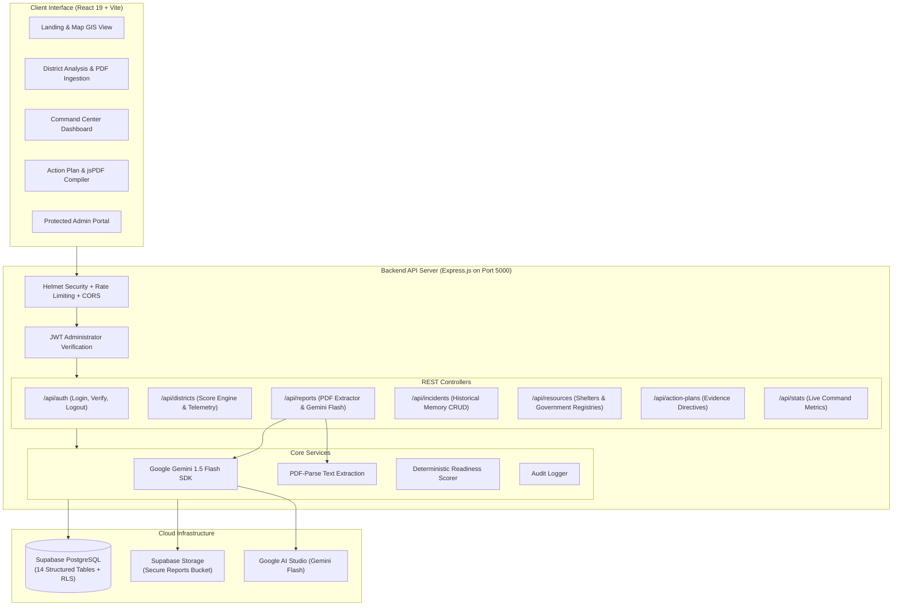

# RESILIENCE AI – Disaster Memory & Preparedness Intelligence System
### Smart India Hackathon (SIH) 2026 | National Innovation Platform


---

## 📌 Executive Summary

Every year, India encounters acute natural hazards ranging from landslides in the Western Ghats (Wayanad, Chamoli) to monsoonal riverine floods across the Brahmaputra basin (Assam) and cyclones along the Bay of Bengal coastline. While frontline disaster relief operations are executed, the detailed operational lessons (telemetry alert latencies, evacuation bottlenecks, dyke monitoring failures, and medical supply shortages) are typically buried in voluminous post-disaster PDF audits.

**RESILIENCE AI** establishes a production-grade **"Disaster Memory & Preparedness Intelligence System"**. It extracts critical failure indicators from past disaster audits using Google Gemini AI, cross-references regional historical memory against active infrastructure, calculates transparent preparedness scores, and synthesizes official, evidence-based preparedness action plans with real vector PDF exports.

---

## 🏛️ System Architecture



---

## 🛠️ Technology Stack

| Layer | Technologies & Packages |
|---|---|
| **Frontend** | React 19, Vite, Tailwind CSS, React-Leaflet GIS, Recharts, Lucide React, jsPDF |
| **Backend** | Node.js (ES Modules), Express.js, Helmet, Express-Rate-Limit, CORS, Morgan |
| **Document Processing** | Multer, pdf-parse, Zod validation |
| **AI Engine** | Google Gen AI SDK (`@google/generative-ai`), Gemini 1.5 Flash structured output |
| **Database & Storage**| Supabase PostgreSQL, UUID extensions, Row Level Security (RLS) |
| **Security** | BcryptJS, JSON Web Tokens (JWT), Audit logging |

---

## 📊 Database Schema (14 Supabase Tables)

The complete SQL definitions and migrations are located in:
- [`backend/migrations/001_initial_schema.sql`](file:///c:/Users/987as/Downloads/SIH/backend/migrations/001_initial_schema.sql)
- [`backend/migrations/002_seed_data.sql`](file:///c:/Users/987as/Downloads/SIH/backend/migrations/002_seed_data.sql)

1. `users` — Administrator credentials & secure profile records.
2. `districts` — Geographic boundaries, coordinates, and primary hazards for 36 states & territories.
3. `disaster_reports` — Uploaded official reports, storage URLs, and processing metadata.
4. `report_analyses` — Structured Gemini AI findings, extracted evidence, and gaps.
5. `historical_incidents` — Centralized disaster memory (1998–2024 incidents).
6. `disaster_events` — Real-time and seasonal disaster occurrence logs.
7. `shelters` — Relief camps, raised flood platforms, capacities, and coordinates.
8. `hospitals` — Healthcare infrastructure, emergency ICU bed counts, and trauma facilities.
9. `emergency_resources` — SDRF units, rescue boats, sensors, and water pumps.
10. `preparedness_scores` — Transparent multi-indicator preparedness indexes.
11. `action_plans` — Formulated operational directives and responsible agency assignments.
12. `data_sources` — Official government registries (ASDMA, GSI, BMTPC, IMD).
13. `uploaded_datasets` — Cataloged spatial GeoJSON and CSV datasets.
14. `audit_logs` — Immutable administrative actions and security access logs.

---

## 📐 Transparent Preparedness Scoring Algorithm

Preparedness scores ($S \in [0, 100]$) are computed deterministically rather than from random or simulated values:

$$S = 0.30 \cdot W_{\text{warning}} + 0.25 \cdot C_{\text{shelter}} + 0.25 \cdot E_{\text{evacuation}} + 0.20 \cdot M_{\text{medical}}$$

- **Warning System ($W$):** Early warning telemetry, automated siren links, and sensor density.
- **Shelter Capacity ($C$):** Ratio of verified safe relief shelters to vulnerable population density.
- **Evacuation Routes ($E$):** All-weather route clearance and arterial bridge resilience.
- **Medical Resources ($M$):** Emergency triage beds and medical stockpiles.

> **Integrity Rule:** If official verified data for any indicator is unavailable, the system explicitly displays: **"Insufficient verified data"**.

---

## 🚀 Running the Project Locally

### 1. Prerequisites
- Node.js (v18 or higher)
- npm or pnpm

### 2. Configure Environment Variables
Copy the example environment files:
```bash
# Backend environment configuration
cp backend/.env.example backend/.env
```

Edit `backend/.env` with your API keys:
```env
PORT=5000
NODE_ENV=development
JWT_SECRET=resilience_ai_secure_jwt_secret_key_production_2026
ADMIN_EMAIL=admin@resilience.gov.in
ADMIN_PASSWORD=ResilienceAdmin#2026
GEMINI_API_KEY=your-gemini-api-key-from-google-ai-studio
SUPABASE_URL=https://your-project.supabase.co
SUPABASE_SERVICE_ROLE_KEY=your-supabase-service-role-key
```

### 3. Start Backend & Frontend

```bash
# Terminal 1: Start Backend API (Port 5000)
cd backend
npm install
npm start

# Terminal 2: Start Frontend Application (Port 5173)
npm install
npm run dev
```

- **Frontend URL:** [http://localhost:5173](http://localhost:5173)
- **Backend API:** [http://localhost:5000/api](http://localhost:5000/api)
- **Health Check:** [http://localhost:5000/api/health](http://localhost:5000/api/health)

---

## 🔐 Administrator Access Credentials

Access the **Admin Portal** from the top navigation bar:
- **Email:** `admin@resilience.gov.in`
- **Password:** `ResilienceAdmin#2026`

*(Public registration is disabled per security specification; only the designated administrator account is authorized).*

---

## 📡 REST API Reference

| Endpoint | Method | Access | Description |
|---|---|---|---|
| `/api/health` | GET | Public | Server uptime and health status |
| `/api/auth/login` | POST | Public | Authenticates admin, returns 7-day JWT |
| `/api/auth/verify` | GET | Admin | Verifies active administrator JWT session |
| `/api/auth/logout` | POST | Admin | Invalidates administrator session |
| `/api/districts` | GET | Public | Lists all monitored districts |
| `/api/districts/:id` | GET | Public | District details, verified shelters, and score |
| `/api/reports/upload` | POST | Public/Admin | Uploads PDF report, extracts text, calls Gemini AI |
| `/api/incidents` | GET | Public | Fetches historical disaster memory records |
| `/api/incidents` | POST | Admin | Registers new verified disaster incident |
| `/api/resources/shelters` | GET | Public | Lists emergency relief shelters with GIS coordinates |
| `/api/resources/shelters/batch` | POST | Admin | Imports shelter datasets in batch |
| `/api/action-plans/:districtId` | GET | Public | Formulates district-specific action plan |
| `/api/stats` | GET | Public | Real-time command metrics and audit summaries |

---

## ☁️ Deployment Guide

### Frontend Deployment (Vercel)
1. Import the repository on Vercel.
2. Build Settings:
   - Framework Preset: `Vite`
   - Build Command: `npm run build`
   - Output Directory: `dist`
3. Environment Variables:
   - `VITE_API_BASE_URL`: `https://your-backend-api.onrender.com/api`

### Backend Deployment (Render / Railway)
1. Deploy from the `backend/` directory as a Node.js Web Service.
2. Build Command: `npm install`
3. Start Command: `node server.js`
4. Add all environment variables from `backend/.env.example`.

### Supabase Database Setup
1. Create a new project in [Supabase](https://supabase.com/).
2. Open the **SQL Editor** in the Supabase Dashboard.
3. Run `backend/migrations/001_initial_schema.sql` to initialize all 14 tables and security policies.
4. Run `backend/migrations/002_seed_data.sql` to load baseline verified government records.
5. Create a private Storage bucket named `disaster-reports`.
